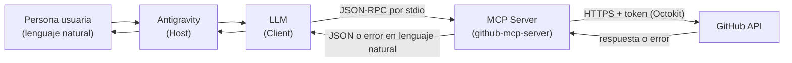
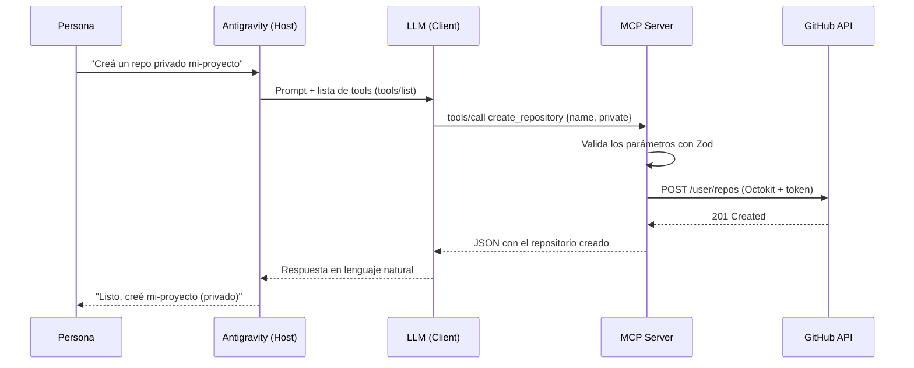

# github-mcp-server

MCP Server en **Node.js + TypeScript** que permite a un agente de IA (Gemini, Claude u otro LLM soportado) ejecutar operaciones en **GitHub usando lenguaje natural**, conectado a **Antigravity** por `stdio`.

Proyecto Integrador 5 (especialización Backend) de Henry, desarrollado como el MVP de **AutomateHub**, una startup que crea herramientas de automatización para equipos de desarrollo.


---

## Tabla de contenidos

1. [Descripción del proyecto](#1-descripción-del-proyecto)
2. [Por qué es útil (casos de uso)](#2-por-qué-es-útil-casos-de-uso)
3. [Requisitos del sistema](#3-requisitos-del-sistema)
4. [Quickstart](#4-quickstart)
5. [Instalación paso a paso](#5-instalación-paso-a-paso)
6. [Configuración](#6-configuración)
   - [6.1 Cómo obtener el GitHub Personal Access Token](#61-cómo-obtener-el-github-personal-access-token)
   - [6.2 Qué scopes necesita el token](#62-qué-scopes-necesita-el-token)
   - [6.3 Cómo configurar el `.env`](#63-cómo-configurar-el-env)
   - [6.4 Cómo configurar el MCP Server en Antigravity](#64-cómo-configurar-el-mcp-server-en-antigravity)
   - [6.5 Cómo verificar que funciona](#65-cómo-verificar-que-funciona)
   - [6.6 Alternativa: usar el server con Claude Desktop (opcional)](#66-alternativa-usar-el-server-con-claude-desktop-opcional)
7. [Catálogo de tools](#7-catálogo-de-tools)
8. [Ejemplos de uso](#8-ejemplos-de-uso)
9. [Arquitectura](#9-arquitectura)
10. [Manejo de errores](#10-manejo-de-errores)
11. [Tests](#11-tests)
12. [Scripts de npm](#12-scripts-de-npm)
13. [Troubleshooting](#13-troubleshooting)
14. [Release checklist](#14-release-checklist)
15. [Licencia](#15-licencia)

---

## 1. Descripción del proyecto

`github-mcp-server` es un servidor que implementa el **Model Context Protocol (MCP)** y expone **5 tools** para operar sobre GitHub. El servidor no tiene interfaz propia: lo usa un agente de IA dentro de Antigravity. La persona escribe lo que necesita en lenguaje natural ("creá un repo privado llamado mi-proyecto"), el LLM decide qué tool usar y con qué parámetros, y el server ejecuta la operación contra la API de GitHub.

**Qué hace:**

| Tool | Tipo | Qué permite |
|---|---|---|
| `create_repository` | Escritura | Crear un repositorio nuevo con nombre y descripción |
| `create_issue` | Escritura | Abrir un issue en un repositorio con título y body |
| `list_repositories` | Lectura | Listar los repositorios del usuario autenticado |
| `create_commit` | Escritura | Crear o modificar un archivo en un repositorio mediante un commit |
| `list_issues` | Lectura | Listar los issues de un repositorio específico |

**Qué lo distingue:**

- **Schemas de Zod bien descriptos.** Cada campo tiene una descripción pensada para que el LLM elija la tool correcta y complete bien los parámetros.
- **Errores en lenguaje natural.** Un 404 de GitHub se transforma en *"El repositorio octocat/nada no fue encontrado. Verifica el nombre e intenta de nuevo."*, no en un stack trace.
- **Código por capas** (tools, schemas, github, errors, utils), con el cliente de Octokit separado de las operaciones para poder mockearlo en los tests.
- **Retry con exponential backoff** que respeta los límites de GitHub y no duplica recursos al reintentar.
- **48 tests con Vitest**, todos con Octokit mockeado: no llaman nunca a la API real.

---

## 2. Por qué es útil (casos de uso)

Automatizar tareas repetitivas de GitHub sin salir del editor ni recordar comandos o endpoints:

- **Arrancar un proyecto nuevo:** "Creá un repo privado `api-pagos` con la descripción 'Servicio de pagos' y subile un README".
- **Triage de issues:** "Listame los issues abiertos de `mi-usuario/mi-repo`" para revisar qué hay pendiente antes de una reunión.
- **Reportar problemas rápido:** "Abrí un issue en `mi-repo` titulado 'Falla el login' con los pasos para reproducirlo" mientras seguís programando.
- **Documentar sobre la marcha:** "Agregá `docs/decisiones.md` al repo con este contenido y el commit 'Documenta decisiones de diseño'".
- **Descubrir tus repos:** "¿Qué repositorios privados tengo?", útil para encontrar el nombre exacto antes de operar sobre uno.

Como el agente combina las tools por su cuenta (por ejemplo, primero `list_repositories` para encontrar el nombre exacto y después `create_issue`), una sola frase puede disparar varios pasos.

---

## 3. Requisitos del sistema

| Requisito | Versión / detalle |
|---|---|
| **Node.js** | **22.19 o superior** (campo `engines` del `package.json`; `.nvmrc` fija la serie 22) |
| **npm** | Viene incluido con Node.js |
| **Git** | Para clonar el repositorio |
| **Cuenta de GitHub** | Con permiso para generar un Personal Access Token |
| **Antigravity** | IDE/Host donde se conecta el server |

Para verificar tu versión de Node:

```bash
node -v
```

Si usás `nvm`, el archivo `.nvmrc` te elige la serie correcta con `nvm use`.

---

## 4. Quickstart

Los pasos mínimos para tenerlo corriendo. Cada uno se explica en detalle más abajo.

```bash
# 1. Clonar e instalar
git clone https://github.com/scarfcarob/github-mcp-server.git
cd github-mcp-server
npm install

# 2. Crear el .env y pegar tu token (ver sección 6.1)
cp .env.example .env        # En Windows PowerShell: Copy-Item .env.example .env

# 3. Compilar TypeScript
npm run build

# 4. Registrar dist/server.js en Antigravity (ver sección 6.4) y probar un prompt
```

Prompt de prueba para el agente: *"Listame mis repositorios de GitHub"*.

---

## 5. Instalación paso a paso

**Paso 1. Clonar el repositorio**

```bash
git clone https://github.com/scarfcarob/github-mcp-server.git
cd github-mcp-server
```

**Paso 2. Instalar las dependencias**

```bash
npm install
```

Instala, entre otras, `@modelcontextprotocol/sdk` (SDK oficial de MCP), `@octokit/rest` (cliente oficial de la API de GitHub), `zod` (validación de schemas) y `dotenv`. Para desarrollo: `typescript`, `vitest` y `tsx`.

**Paso 3. Configurar las variables de entorno**

Seguí la sección [6.3](#63-cómo-configurar-el-env).

**Paso 4. Compilar TypeScript**

```bash
npm run build
```

Genera la carpeta `dist/`. El archivo que Antigravity va a ejecutar es `dist/server.js`.

**Paso 5. Verificar que todo está sano (opcional, recomendado)**

```bash
npm run typecheck
npm test
```

Tienen que pasar los 48 tests.

**Paso 6. Conectar el server a Antigravity**

Seguí la sección [6.4](#64-cómo-configurar-el-mcp-server-en-antigravity).

---

## 6. Configuración

### 6.1 Cómo obtener el GitHub Personal Access Token

El token es la credencial con la que el server actúa en tu nombre en GitHub. Para este proyecto se recomienda un **token clásico (classic)**.

1. Iniciá sesión en GitHub.
2. Entrá directamente a **https://github.com/settings/tokens**, o navegá: foto de perfil (arriba a la derecha) → **Settings** → **Developer settings** (al final del menú izquierdo) → **Personal access tokens** → **Tokens (classic)**.
3. Hacé clic en **Generate new token** → **Generate new token (classic)**. GitHub puede pedirte la contraseña o un código de verificación.
4. En **Note**, poné un nombre que te permita reconocerlo, por ejemplo `github-mcp-server`.
5. En **Expiration**, elegí una duración corta (por ejemplo 30 días). Un token que vence limita el daño si se filtra.
6. En **Select scopes**, tildá el scope indicado en la sección [6.2](#62-qué-scopes-necesita-el-token).
7. Hacé clic en **Generate token**.
8. **Copiá el token ahora** (empieza con `ghp_`). GitHub lo muestra **una sola vez**; si cerrás la página, tenés que generar uno nuevo.

> ⚠️ **Seguridad.** El token da acceso a tus repositorios. No lo pegues en el código, en capturas, en el chat ni en ningún archivo que se suba a GitHub. Si se expone por error, **revocalo de inmediato** en la misma página de tokens y generá uno nuevo.

### 6.2 Qué scopes necesita el token

| Scope | ¿Se necesita? | Para qué |
|---|---|---|
| **`repo`** | **Sí (obligatorio)** | Crear y listar repositorios (incluidos los privados), crear y listar issues y crear commits |
| `user` | No para estas 5 tools | Leer o modificar datos del perfil. Ninguna tool actual lo usa |
| `admin:org` | No para estas 5 tools | Administrar organizaciones. Ninguna tool actual lo usa |

Estas 5 tools alcanzan con **`repo`**. Se recomienda no sumar `user` ni `admin:org` mientras no hagan falta (**principio de mínimo privilegio**): cuanto menos permiso tenga el token, menos daño puede hacer si se filtra. Si más adelante se agregan tools que operen sobre organizaciones o perfiles, ahí sí corresponde ampliar los scopes.

Un token sin el scope correcto devuelve un **403** que puede confundirse con un bug del código. Ante un 403, verificá primero los scopes (ver [Troubleshooting](#13-troubleshooting)).

### 6.3 Cómo configurar el `.env`

El proyecto incluye `.env.example` con las variables necesarias y **sin valores reales**. Copialo a `.env` y completalo:

```bash
cp .env.example .env              # macOS / Linux / Git Bash
Copy-Item .env.example .env       # Windows PowerShell
```

Contenido del `.env`:

```env
GITHUB_TOKEN=ghp_tu_token_aca
LOG_LEVEL=info
```

| Variable | Requerida | Descripción |
|---|---|---|
| `GITHUB_TOKEN` | **Sí** | Personal Access Token de GitHub (ver 6.1). Sin él, todas las tools responden `AUTH_ERROR` |
| `LOG_LEVEL` | No | Nivel de logs: `debug`, `info` (por defecto), `warn`, `error` o `silent` |

Detalles importantes:

- El `.env` está en `.gitignore`: **nunca se commitea**. Antes de tu primer commit verificá que siga ahí.
- El server lee el `.env` **desde la raíz del proyecto por ruta absoluta**, así que funciona aunque Antigravity lo ejecute desde otra carpeta.
- Cada vez que cambies el `.env`, **reiniciá el server** (refrescalo desde Antigravity) para que tome los valores nuevos.

### 6.4 Cómo configurar el MCP Server en Antigravity

El server se comunica con Antigravity por **stdio** (entrada y salida estándar), así que Antigravity lo ejecuta como un proceso local con `node`.

1. **Compilá el proyecto** (`npm run build`). Tiene que existir `dist/server.js`.
2. **Averiguá la ruta absoluta** de `dist/server.js`. Por ejemplo, desde la carpeta del proyecto:
   - Windows PowerShell: `(Resolve-Path dist/server.js).Path`
   - macOS / Linux: `realpath dist/server.js`
3. En Antigravity, abrí el menú **(...)** de la ventana del Agente → **Manage MCP Servers** → **View raw config**. Se abre el archivo **`mcp_config.json`**.
4. Agregá el server dentro de `mcpServers`:

```json
{
  "mcpServers": {
    "github-mcp-server": {
      "command": "node",
      "args": ["C:/ruta/absoluta/a/github-mcp-server/dist/server.js"]
    }
  }
}
```

5. Guardá el archivo y, en la pantalla **Manage MCP servers**, hacé clic en **Refresh**. El server tiene que aparecer en la lista con sus **5 tools habilitadas (5/5)**.

Notas:

- **Windows:** escribí la ruta con barras normales (`C:/Users/...`) o con barras invertidas dobles (`C:\\Users\\...`). Una barra invertida simple rompe el JSON.
- **El token no va en este archivo.** El server lo toma del `.env`. Si preferís pasarlo desde la configuración, podés agregar un bloque `"env": { "GITHUB_TOKEN": "..." }`, pero entonces ese archivo contiene un secreto: no lo compartas ni lo subas a ningún repositorio.
- Si ya tenías otros servidores en `mcp_config.json`, agregá este dentro del mismo objeto `mcpServers`, separado por coma.
- La ubicación exacta de los menús puede variar entre versiones de Antigravity. Lo que importa es llegar al archivo `mcp_config.json`.
- Antigravity puede mostrar el server en la lista con otro nombre que el de la clave del JSON (por ejemplo, "GitHub"). No es un problema: lo que cuenta es que figuren las 5 tools habilitadas.

### 6.5 Cómo verificar que funciona

**Opción A: MCP Inspector (antes de conectar con Antigravity).** Es la herramienta oficial de debugging para servidores MCP:

```bash
npx @modelcontextprotocol/inspector node dist/server.js
```

Abrí la URL que muestra la terminal, hacé clic en **Connect**, andá a la pestaña **Tools** → **List Tools**: tienen que aparecer las 5 tools. Desde ahí podés ejecutarlas con parámetros a mano.

**Opción B: desde Antigravity.**

1. Abrí **Manage MCP servers**: el server tiene que figurar con las 5 tools habilitadas (`list_repositories`, `create_issue`, `create_commit`, `create_repository` y `list_issues`), cada una con su descripción.
2. Pedile al agente: *"Listame mis repositorios de GitHub"*. Si responde con tus repos, está todo funcionando.

Al iniciar, el server escribe en **stderr** una línea como esta (los logs nunca van a stdout, que está reservado para el protocolo):

```json
{"ts":"...","level":"info","msg":"server iniciado","name":"github-mcp-server","version":"1.0.0","tools":["list_repositories","create_issue","create_commit","create_repository","list_issues"]}
```

### 6.6 Alternativa: usar el server con Claude Desktop (opcional)

Como el server cumple el estándar MCP, no depende de un solo cliente: también funciona con otros hosts. Antigravity sigue siendo la configuración principal de este proyecto; esta sección es solo una alternativa que se probó y funciona.

1. Compilá el proyecto (`npm run build`).
2. En Claude Desktop abrí **Configuración → Desarrollador → Editar configuración**. Se abre el archivo de configuración.
3. Agregá el mismo bloque que usaste en Antigravity:

```json
{
  "mcpServers": {
    "github-mcp-server": {
      "command": "node",
      "args": ["C:/ruta/absoluta/a/github-mcp-server/dist/server.js"]
    }
  }
}
```

4. Guardá y reiniciá Claude Desktop. En **Configuración → Desarrollador**, el server tiene que figurar como **"En ejecución"**; el botón **Ver registros** muestra los logs de arranque.
5. Al usar una tool, Claude pide aprobación: **Permitir una vez**, **Permitir siempre** o **Denegar**. Para las tools de escritura (`create_repository`, `create_issue`, `create_commit`) conviene elegir **Permitir una vez**, así revisás cada acción antes de que se ejecute.

> Los nombres exactos de los menús pueden variar según la versión de la aplicación.

---

## 7. Catálogo de tools

Todas las tools devuelven el resultado como JSON en texto y también como `structuredContent`. Si algo falla, devuelven un error con la forma descripta en [Manejo de errores](#10-manejo-de-errores).

### `create_repository`

**Descripción.** Crea un repositorio **nuevo** en la cuenta del usuario dueño del token. Es privado por defecto: solo se crea público si se pide de forma expresa. Si el nombre ya existe, falla sin modificar nada. Tipo: **escritura**.

**Parámetros**

| Campo | Tipo | Requerido | Restricciones | Descripción |
|---|---|---|---|---|
| `name` | string | Sí | 3 a 100 caracteres; solo letras, números, `-` y `_` | Nombre del repositorio nuevo |
| `description` | string | No | Hasta 350 caracteres | Descripción corta |
| `private` | boolean | No | Por defecto `true` | `true` = privado, `false` = público |

**Prompts que funcionan bien**

- *"Creá un repositorio privado llamado `mi-proyecto-demo` con la descripción 'Proyecto de práctica'."*
- *"Creame un repo público que se llame `portfolio-2026`."*

**Salida esperada**

```json
{
  "repository": {
    "full_name": "scarfcarob/mi-proyecto-demo",
    "owner": "scarfcarob",
    "name": "mi-proyecto-demo",
    "private": true,
    "description": "Proyecto de práctica",
    "html_url": "https://github.com/scarfcarob/mi-proyecto-demo"
  }
}
```

**Errores comunes**

| Situación | Resultado |
|---|---|
| Nombre con espacios, menos de 3 o más de 100 caracteres | `VALIDATION_ERROR`; no se llama a GitHub |
| El nombre ya existe en tu cuenta | `GITHUB_API_ERROR` (422): GitHub rechaza los datos |
| Token sin scope `repo` | `GITHUB_API_ERROR` (403): sin permiso |

---

### `create_issue`

**Descripción.** Abre un issue **nuevo** en un repositorio. Antes de crearlo verifica que el repo exista y tenga los issues activados. No sirve para modificar ni cerrar issues existentes. Tipo: **escritura**.

**Parámetros**

| Campo | Tipo | Requerido | Restricciones | Descripción |
|---|---|---|---|---|
| `owner` | string | Sí | No vacío | Dueño del repo (usuario u organización) |
| `repo` | string | Sí | No vacío | Nombre del repo, sin el owner |
| `title` | string | Sí | 3 a 256 caracteres | Título del issue |
| `body` | string | No | Hasta 65.000 caracteres | Descripción en markdown |
| `labels` | string[] | No | Hasta 10; deben existir en el repo | Etiquetas, por ejemplo `["bug"]` |

**Prompts que funcionan bien**

- *"Abrí un issue en `scarfcarob/mi-proyecto-demo` con el título 'Falla el login' y en la descripción poné los pasos para reproducirlo."*
- *"Creá un issue 'Agregar tests de integración' en mi repo `mi-proyecto-demo` con el label `enhancement`."* (el agente puede usar antes `list_repositories` para encontrar tu `owner`)

**Salida esperada**

```json
{
  "issue": {
    "number": 1,
    "title": "Falla el login",
    "state": "open",
    "html_url": "https://github.com/scarfcarob/mi-proyecto-demo/issues/1",
    "labels": []
  }
}
```

**Errores comunes**

| Situación | Resultado |
|---|---|
| Título con menos de 3 caracteres | `VALIDATION_ERROR` |
| El repo no existe o el token no lo ve | `GITHUB_API_ERROR` (404): *"El repositorio owner/repo no fue encontrado. Verifica el nombre e intenta de nuevo."* |
| El repo tiene los issues desactivados | `GITHUB_API_ERROR`: indica activarlos en Settings → General → Features → Issues |
| Un label que no existe | `GITHUB_API_ERROR` (422) |

---

### `list_repositories`

**Descripción.** Lista los repositorios del usuario dueño del token. Sirve para descubrir qué repos existen y obtener el `owner` y el nombre exactos antes de crear issues o commits. No lista repos de otros usuarios. Tipo: **lectura**.

**Parámetros**

| Campo | Tipo | Requerido | Valores | Descripción |
|---|---|---|---|---|
| `type` | string | No | `all` (por defecto), `public`, `private` | Qué repos listar |
| `sort` | string | No | `created`, `updated` (por defecto), `pushed`, `full_name` | Orden del listado |
| `per_page` | entero | No | 1 a 100 (por defecto 30) | Cantidad a devolver |

**Prompts que funcionan bien**

- *"Listame mis repositorios de GitHub."*
- *"Mostrame solo mis repos privados, los 10 más recientes."*

**Salida esperada**

```json
{
  "count": 2,
  "repositories": [
    {
      "full_name": "scarfcarob/mi-proyecto-demo",
      "owner": "scarfcarob",
      "name": "mi-proyecto-demo",
      "private": true,
      "description": "Proyecto de práctica",
      "html_url": "https://github.com/scarfcarob/mi-proyecto-demo"
    }
  ]
}
```

**Errores comunes**

| Situación | Resultado |
|---|---|
| Falta `GITHUB_TOKEN` o venció | `AUTH_ERROR` |
| `per_page` fuera de 1 a 100 | `VALIDATION_ERROR` |

---

### `create_commit`

**Descripción.** Crea o modifica **un** archivo de texto en un repositorio haciendo un commit. Si el archivo ya existe, **lo reemplaza completo** con el contenido nuevo. Si no se indica rama, usa la rama principal del repo. El commit queda en el historial. Tipo: **escritura**.

**Parámetros**

| Campo | Tipo | Requerido | Restricciones | Descripción |
|---|---|---|---|---|
| `owner` | string | Sí | No vacío | Dueño del repo |
| `repo` | string | Sí | No vacío | Nombre del repo |
| `path` | string | Sí | Sin `/` al inicio y sin `..` | Ruta del archivo en el repo, por ejemplo `docs/notas.md` |
| `content` | string | Sí | Texto | Contenido **completo** del archivo |
| `message` | string | Sí | 1 a 500 caracteres | Mensaje del commit |
| `branch` | string | No | La rama debe existir | Rama destino; por defecto, la principal |

**Prompts que funcionan bien**

- *"En `scarfcarob/mi-proyecto-demo` creá el archivo `README.md` con el texto '# Mi proyecto' y el commit 'Agrega README inicial'."*
- *"Modificá `docs/notas.md` de mi repo `mi-proyecto-demo` para que diga 'Reunión del lunes: definir alcance' con el mensaje de commit 'Actualiza notas'."*

**Salida esperada**

```json
{
  "commit": {
    "commit_sha": "a1b2c3d4e5f6...",
    "commit_url": "https://github.com/scarfcarob/mi-proyecto-demo/commit/a1b2c3d4e5f6...",
    "branch": "main",
    "path": "README.md",
    "file_url": "https://github.com/scarfcarob/mi-proyecto-demo/blob/main/README.md"
  }
}
```

**Cómo funciona por dentro.** Usa la API de datos de Git de GitHub: toma la punta de la rama, crea el contenido (blob), arma un árbol nuevo, crea el commit y mueve la referencia de la rama al commit nuevo (6 pasos). No fuerza el movimiento de la rama (`force: false`), así que nunca pisa el trabajo de otra persona.

**Errores comunes**

| Situación | Resultado |
|---|---|
| `path` con `/` inicial o con `..` | `VALIDATION_ERROR` |
| La rama indicada no existe | `GITHUB_API_ERROR` (404): *"La rama X no existe en owner/repo."* |
| El repo está vacío (sin commits) | `GITHUB_API_ERROR` (409): pide crear primero un archivo desde GitHub |
| Otra persona hizo un commit en la rama mientras se creaba el tuyo | `GITHUB_API_ERROR` (422): volvé a ejecutar la tool |
| Token sin permiso de escritura sobre el repo | `GITHUB_API_ERROR` (403) |

---

### `list_issues`

**Descripción.** Lista los issues de un repositorio específico (número, título, estado, link y labels). **No incluye pull requests.** Por defecto muestra solo los abiertos. Tipo: **lectura**.

**Parámetros**

| Campo | Tipo | Requerido | Valores | Descripción |
|---|---|---|---|---|
| `owner` | string | Sí | No vacío | Dueño del repo |
| `repo` | string | Sí | No vacío | Nombre del repo |
| `state` | string | No | `open` (por defecto), `closed`, `all` | Qué issues listar |
| `per_page` | entero | No | 1 a 100 (por defecto 30) | Cantidad máxima a devolver |

**Prompts que funcionan bien**

- *"Listame los issues abiertos de `scarfcarob/mi-proyecto-demo`."*
- *"¿Qué issues cerrados tiene mi repo `mi-proyecto-demo`?"*

**Salida esperada**

```json
{
  "count": 1,
  "issues": [
    {
      "number": 1,
      "title": "Falla el login",
      "state": "open",
      "html_url": "https://github.com/scarfcarob/mi-proyecto-demo/issues/1",
      "labels": ["bug"]
    }
  ]
}
```

**Errores comunes**

| Situación | Resultado |
|---|---|
| El repo no existe o no es accesible | `GITHUB_API_ERROR` (404) |
| `state` con un valor distinto de `open`, `closed` o `all` | `VALIDATION_ERROR` |
| El repo tiene los issues desactivados | `GITHUB_API_ERROR` (410) |

---

## 8. Ejemplos de uso

### Flujo completo: de cero a un repo con documentación y un issue

Una sesión de ejemplo que usa las **5 tools** en orden. Cada línea es un prompt para el agente en Antigravity.

| # | Prompt | Tool que usa el agente |
|---|---|---|
| 1 | *"Creá un repositorio privado llamado `demo-mcp` con la descripción 'Prueba del MCP server'."* | `create_repository` |
| 2 | *"Listame mis repositorios y confirmame que `demo-mcp` aparece."* | `list_repositories` |
| 3 | *"En `demo-mcp` creá el archivo `README.md` con el texto '# Demo MCP' y el commit 'Agrega README inicial'."* | `create_commit` |
| 4 | *"Abrí un issue en `demo-mcp` titulado 'Agregar licencia' con el label `documentation`."* | `create_issue` |
| 5 | *"Mostrame los issues abiertos de `demo-mcp`."* | `list_issues` |

> En el paso 4, el label tiene que existir en el repo. GitHub crea por defecto `documentation` en los repositorios nuevos, pero si lo borraste, el agente va a recibir un error 422 explicando el problema.

### Ejemplos de errores (cómo responde el server)

**Validación (no se llama a GitHub).** Prompt: *"Creá un repo llamado `mi proyecto`"* (con espacio).

```json
{
  "code": "VALIDATION_ERROR",
  "message": "Input inválido: name: name solo puede tener letras, números, guiones (-) y guiones bajos (_), sin espacios ni otros símbolos. No se llamó a GitHub.",
  "retryable": false,
  "action": "FIX_INPUT",
  "hint": "Corregí los campos indicados en details y volvé a llamar a la tool."
}
```

**Recurso inexistente.** Prompt: *"Listame los issues de `scarfcarob/repo-que-no-existe`"*.

```json
{
  "code": "GITHUB_API_ERROR",
  "message": "El repositorio scarfcarob/repo-que-no-existe no fue encontrado. Verifica el nombre e intenta de nuevo.",
  "retryable": false,
  "action": "CHECK_RESOURCE",
  "hint": "Revisá owner y repo (mayúsculas y guiones). Si el repo es privado, el token tiene que tener acceso."
}
```

El agente recibe este objeto y se lo comunica a la persona con sus propias palabras, indicando qué corregir.

---

## 9. Arquitectura

Hay tres componentes que conviene no confundir:

| Componente | Rol | Quién es |
|---|---|---|
| **Host** | Gestiona la sesión y conecta las piezas | Antigravity |
| **Client** | Recibe el prompt, **decide qué tool usar** leyendo sus descripciones y con qué parámetros | El LLM (Gemini, Claude u otro) |
| **Server** | Expone las tools, valida inputs con Zod y ejecuta las operaciones | **Este proyecto** |

La pieza final es la **API de GitHub**, a la que el server llama de forma autenticada a través de Octokit.

### Diagrama de flujo



### Secuencia de una solicitud



### Por qué la comunicación es por stdio

El Host ejecuta el server como un **proceso hijo** y se comunica por entrada y salida estándar usando mensajes JSON-RPC: es simple, no abre puertos de red y no necesita autenticación propia. La consecuencia es una regla estricta: **stdout está reservado para el protocolo**. Cualquier `console.log` en medio de esa comunicación rompería el mensaje, por eso todos los logs de este proyecto salen por **stderr**.

### Estructura del proyecto

```
github-mcp-server/
├── src/
│   ├── server.ts              # Entry point: registra las tools y abre el transporte stdio
│   ├── types.ts               # Tipos compartidos (McpTool, RepoDTO, IssueDTO, CommitDTO)
│   ├── tools/                 # Una tool por archivo: descripción para el LLM + handler
│   │   ├── create-repository.ts
│   │   ├── create-issue.ts
│   │   ├── list-repositories.ts
│   │   ├── create-commit.ts
│   │   └── list-issues.ts
│   ├── schemas/
│   │   └── index.ts           # Schemas de Zod de cada tool (validación + JSON Schema para el LLM)
│   ├── github/
│   │   ├── client.ts          # Configuración de Octokit y lectura del token
│   │   └── operations.ts      # Funciones que llaman a la API de GitHub
│   ├── errors/
│   │   └── index.ts           # Errores custom y traducción a lenguaje natural
│   └── utils/
│       ├── logging.ts         # Logger estructurado que escribe en stderr
│       └── retry.ts           # Reintentos con exponential backoff
├── tests/
│   ├── tools.test.ts          # Validación de schemas y comportamiento de las tools
│   ├── github.test.ts         # Operaciones de GitHub con Octokit mockeado
│   └── errors.test.ts         # Transformación de errores a lenguaje natural
├── .env.example               # Variables necesarias, sin valores reales
├── .gitignore
├── .nvmrc
├── LICENSE
├── package.json
├── tsconfig.json
└── vitest.config.ts
```

### Decisiones de diseño

- **Capas con una sola responsabilidad.** Las tools solo validan y traducen; las operaciones hablan con GitHub; los errores y el logging viven aparte. Cambiar una capa no obliga a tocar las demás.
- **`client.ts` separado de `operations.ts`.** Permite reemplazar Octokit por un mock en los tests sin modificar la lógica. Si todo estuviera mezclado, testear sin llamar a la API real sería mucho más difícil.
- **Descripciones pensadas para el LLM.** Quien decide qué tool usar es el modelo, leyendo sus descripciones. Por eso cada tool dice qué hace, qué requiere, si escribe o solo lee, y qué **no** sirve para hacer (por ejemplo, `create_commit` aclara que no crea issues ni repos).
- **Un schema, tres usos.** Cada schema de Zod valida en runtime, infiere el tipo de TypeScript y genera el JSON Schema que lee el LLM, así que nunca se desincronizan.
- **Seguro por defecto.** `create_repository` crea repos **privados** salvo que se pida lo contrario, y `create_commit` nunca fuerza el movimiento de una rama.
- **Retry responsable.** Reintentar un error de red al crear un repo o un issue podría duplicarlo (GitHub pudo haberlo creado antes de que se cortara la conexión). Por eso las escrituras solo reintentan ante rate limit; las lecturas también reintentan errores de red y errores 5xx.

---

## 10. Manejo de errores

Todos los errores se clasifican en cuatro categorías propias, más una de respaldo:

| Código | Clase | Cuándo ocurre | Se reintenta |
|---|---|---|---|
| `VALIDATION_ERROR` | `ValidationError` | El input no cumple el schema de Zod (no se llama a GitHub) | No |
| `AUTH_ERROR` | `AuthenticationError` | Token ausente, inválido o vencido (401) | No |
| `GITHUB_API_ERROR` | `GitHubAPIError` | GitHub rechazó la operación: 403, 404, 409, 410, 422, rate limit, 5xx | Solo rate limit y 5xx |
| `NETWORK_ERROR` | `NetworkError` | No hubo respuesta: sin internet, timeout, DNS | Sí (solo en lecturas) |
| `UNKNOWN_ERROR` | `AppError` | Cualquier otro caso inesperado | No |

Cuando una tool falla, devuelve `isError: true` con un objeto pensado para que el LLM sepa **qué pasó y qué hacer**:

```json
{
  "code": "GITHUB_API_ERROR",
  "message": "Qué pasó, en lenguaje natural",
  "retryable": false,
  "action": "CHECK_RESOURCE",
  "hint": "Qué hacer para resolverlo",
  "details": { }
}
```

| Campo `action` | Significado |
|---|---|
| `FIX_INPUT` | Corregir los datos y volver a llamar |
| `ADD_CREDENTIALS` | Configurar o renovar el token |
| `WAIT_AND_RETRY` | Esperar y reintentar |
| `CHECK_RESOURCE` | Revisar que owner, repo o rama existan |
| `CONTACT_SUPPORT` | Revisar los logs del server |

**Reintentos con exponential backoff.** Hasta 3 reintentos, con esperas de 1 s, 2 s y 4 s (tope de 10 s). Si GitHub informa un `retry-after` (rate limit), el server espera ese tiempo en lugar de insistir de inmediato, porque reintentar al instante cuando la API dice "esperá" empeora el problema.

**Logging seguro.** Los logs son JSON por línea, salen por stderr y registran la tool, el código y el mensaje del error. **Nunca incluyen el token** ni el contenido completo de los parámetros: los textos largos se recortan.

---

## 11. Tests

El proyecto tiene **48 tests unitarios** con [Vitest](https://vitest.dev/) repartidos en 3 archivos. **Ninguno llama a la API real de GitHub**: Octokit se reemplaza por un mock, así que los tests son rápidos y deterministas.

| Archivo | Tests | Qué verifica |
|---|---|---|
| `tests/tools.test.ts` | 20 | Schemas: inputs válidos pasan e inválidos fallan con mensajes claros; comportamiento de las tools |
| `tests/github.test.ts` | 21 | Operaciones de GitHub con Octokit mockeado: casos exitosos y casos de error (404, 401, rate limit) |
| `tests/errors.test.ts` | 7 | Transformación de errores técnicos a mensajes en lenguaje natural |

Ejecutar los tests:

```bash
npm test              # corre todos los tests una vez
npm run test:watch    # modo watch: re-ejecuta al guardar cambios
npm run typecheck     # verifica los tipos de TypeScript sin compilar
```

Resultado esperado:

```
 Test Files  3 passed (3)
      Tests  48 passed (48)
```

---

## 12. Scripts de npm

| Script | Comando | Qué hace |
|---|---|---|
| `npm run build` | `tsc -p tsconfig.json` | Compila TypeScript a `dist/` |
| `npm run dev` | `tsx watch src/server.ts` | Ejecuta el server en modo desarrollo, recargando al guardar |
| `npm start` | `node dist/server.js` | Ejecuta el server compilado |
| `npm test` | `vitest run` | Corre los tests una vez |
| `npm run test:watch` | `vitest` | Corre los tests en modo watch |
| `npm run typecheck` | `tsc -p tsconfig.json --noEmit` | Verifica tipos sin generar archivos |

> `npm run dev` y `npm start` esperan mensajes por stdin: si los corrés a mano en una terminal vas a ver el log de inicio y el proceso queda esperando. Es lo normal. Para probar el server de forma interactiva usá el MCP Inspector (sección [6.5](#65-cómo-verificar-que-funciona)).

---

## 13. Troubleshooting

| Error (code) | Causa probable | Acción recomendada |
|---|---|---|
| `AUTH_ERROR` | Falta `GITHUB_TOKEN`, está mal copiado o venció | Revisá el `.env` (sin comillas ni espacios extra), generá un token nuevo si venció y **reiniciá el server** |
| `VALIDATION_ERROR` | Un parámetro falta o no cumple las reglas (por ejemplo, un nombre de repo con espacios) | Corregí el input según la tabla de parámetros de la tool |
| `GITHUB_API_ERROR` (403, sin permiso) | El token no tiene el scope `repo`, o no tenés escritura en ese repo | Verificá los scopes del token en GitHub (sección 6.2) antes de sospechar del código |
| `GITHUB_API_ERROR` (403 / 429, rate limit) | Se superó el límite de requests de GitHub | Esperá hasta la hora que indica el `hint` y reintentá |
| `GITHUB_API_ERROR` (404) | El repositorio no existe, está mal escrito, o es privado y el token no lo ve | Verificá `owner` y `repo` (usá `list_repositories` para ver los nombres exactos) |
| `GITHUB_API_ERROR` (404, rama) | La rama indicada en `create_commit` no existe | Usá una rama existente, o no mandes `branch` para usar la principal |
| `GITHUB_API_ERROR` (409) | El repositorio está vacío (sin commits) | Creá un primer archivo desde GitHub y reintentá |
| `GITHUB_API_ERROR` (410) | El repo tiene los issues desactivados | Activalos en Settings → General → Features → Issues |
| `GITHUB_API_ERROR` (422) | GitHub rechazó los datos: nombre de repo repetido, label o usuario inexistente, o la rama cambió durante el commit | Leé el `message` y los `details`; corregí el dato o volvé a ejecutar |
| `NETWORK_ERROR` | Sin conexión, proxy o problema de DNS | Revisá tu internet y reintentá en unos segundos |
| El server o sus tools no aparecen en Antigravity | JSON inválido, ruta incorrecta, falta compilar, o no se refrescó la lista | Corré `npm run build` y revisá que exista `dist/server.js`; abrí **View raw config** y verificá el JSON (comas, ruta absoluta, barras `/` en Windows); guardá, apretá **Refresh** en Manage MCP servers y, si sigue sin aparecer, cerrá Antigravity por completo y abrilo de nuevo |
| `Cannot find module .../dist/server.js` | No se compiló el proyecto | Ejecutá `npm run build` |
| El server arranca pero el cliente falla al conectar | Algo escribió en stdout y rompió el protocolo | No uses `console.log` en el código: usá el `logger`, que escribe en stderr |
| `GITHUB_TOKEN no está configurado` en los logs | El `.env` no existe o está vacío | Copiá `.env.example` a `.env` y completá el token |
| `npm install` falla o hay errores de sintaxis raros | Versión de Node anterior a la requerida | Actualizá a Node 22.19 o superior (`node -v`) |

Para ver más detalle, subí el nivel de logs en el `.env` (`LOG_LEVEL=debug`) y reiniciá el server: los logs salen por stderr.

---

## 14. Release checklist

- [x] `.env` no está commiteado (está en `.gitignore`)
- [x] `.env.example` actualizado y cubre todas las variables requeridas
- [x] Logs van exclusivamente a `stderr`, sin contaminar `stdout`
- [x] Los errores incluyen `code`, `action` y `retryable`, y nunca filtran información sensible
- [x] Retry limitado y solo para errores transitorios (red, rate limit y 5xx)
- [x] README cubre Quickstart, tools, troubleshooting y prompts de ejemplo
- [x] Scripts de npm (`build`, `start`, `dev`, `test`) funcionan y están documentados
- [x] 48 tests unitarios pasando, sin llamadas reales a GitHub
- [x] `LICENSE` incluido

---

## 15. Licencia

Distribuido bajo la licencia **MIT**. Ver el archivo [LICENSE](./LICENSE).

© 2026 Carolina S. Betlienski
